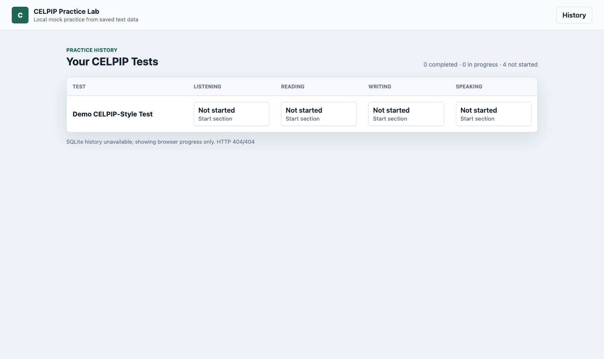
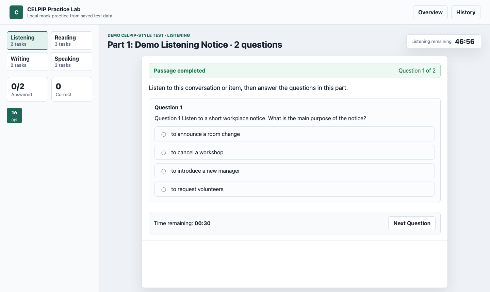
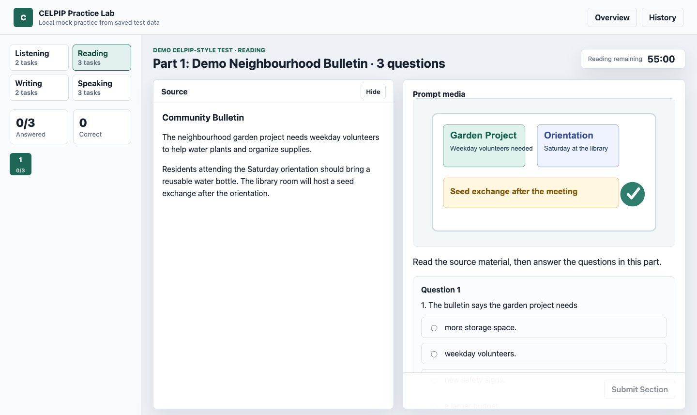
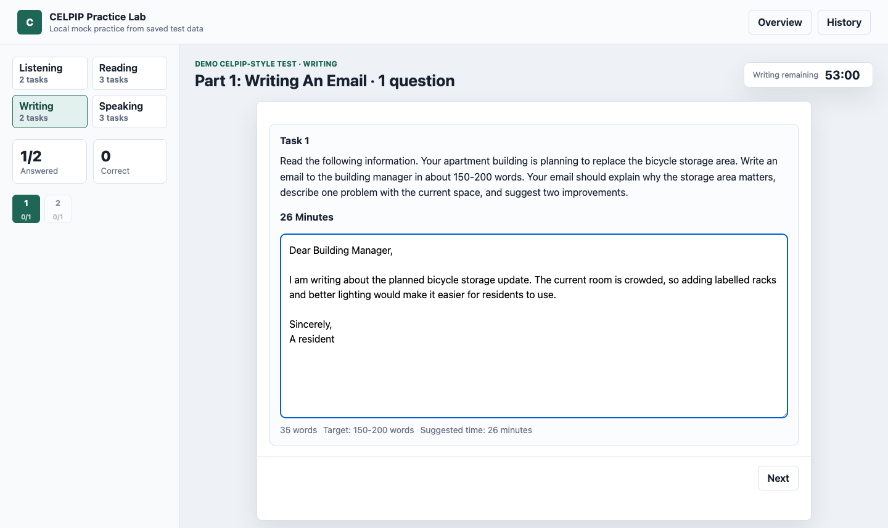
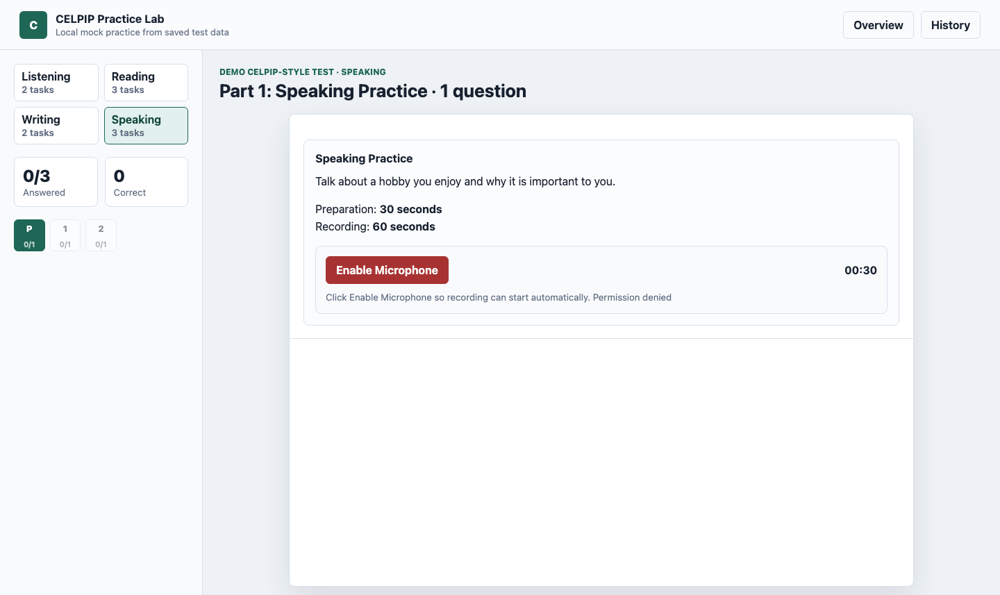
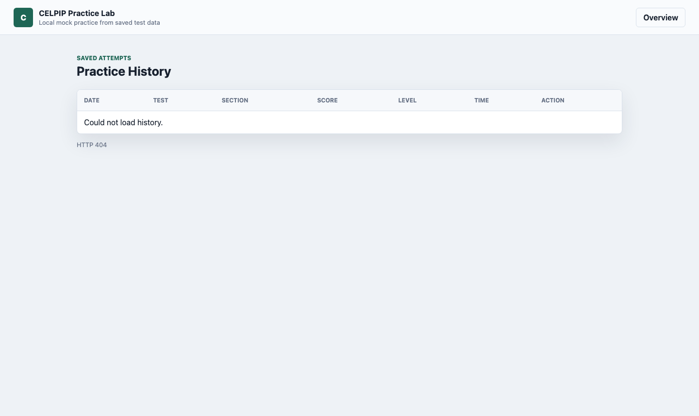

# CELPIP Practice Lab

A local CELPIP-style practice app for Listening, Reading, Writing, and Speaking. It renders material packs, saves drafts in browser localStorage, syncs attempts to SQLite, stores speaking recordings as files, and shows practice history.

Choose **Start mock exam** beside a test to complete Listening → Reading → Writing → Speaking in one session. Sections advance automatically, with independent Reading/Writing timers and automatic Speaking preparation and recording. Scores, correct answers and review controls stay hidden until all four sections are finished. The final results page saves each section to History and provides Writing/Speaking AI grading.

Mock exam progress is separate from single-section practice and is saved in the current browser. Refresh to continue, or use **Save & exit** and **Resume mock exam** on the overview. Previously completed practice does not pre-fill a new mock exam. If a result cannot sync, it stays in the browser and can be retried from the final results page.

After submission, click a completed section on the overview to review its latest saved attempt, including mock exam responses. History also has a **Review** action for each individual attempt. Saved review links survive refreshes and work across browsers; review shows the original answers, feedback and matching speaking recordings without starting a timer or replacing an unfinished practice draft. Use **Practice Again** explicitly to start over.

Writing prompts recover paragraphs and bullet points from saved source pages when imported question data contains only plain text. Model responses and old source-page editors remain excluded from the task prompt.

Listening follows the [official sample's six parts](https://instructionalproducts.paragontesting.ca/InstructionalProducts/FreeOnlineSampleTest/FOST/View/1205f3d4-223b-4581-8ec9-56d185713d5e). Passages start automatically, play once, and have no pause or seek controls; click Start only if your browser blocks automatic playback. Parts 1–3 show one four-choice question at a time, with 30 seconds including the spoken question. Part 1 numbers its eight questions continuously across its three recordings. Parts 4–6 show all 5, 8, or 6 questions as inline drop-downs after the audio or video ends, with answer budgets of 3:30, 4:00, and 4:20. Only the current answer-phase timer is shown. Timeouts advance automatically. A playback failure pauses time until retry, and missing spoken prompts are flagged instead of running a silent countdown. Full mock exams save playback positions and completed question audio so refreshing continues without replaying completed clips.

Reading follows the [official interactive sample](https://instructionalproducts.paragontesting.ca/InstructionalProducts/FreeOnlineSampleTest/FOST/View/43cc4771-b071-4c82-927a-3a75c7c36e35): click the small arrow inside a blank to open the answer choices. Your selection becomes bold, underlined text in the sentence, and the paragraph reflows around it. Click the selected text to change it. Replies in Part 1, diagram emails in Part 2, and comments in Part 4 keep their original paragraphs. Other questions appear as sentence rows in a shared answer panel; Part 3 keeps the A–E paragraph choices. Arrow keys and Enter also work. The four parts have independent 11-, 9-, 10-, and 13-minute timers. You can leave a part early with unanswered questions after confirming; you cannot return to it during the attempt. Timeouts advance without confirmation. Selections save automatically and remain visible during review.

In Listening and Reading review, tap any inline answer or its arrow to see every choice. The menu marks your submitted answer; browsing or tapping other choices keeps that answer and the score unchanged. Correct answers stay hidden until you choose to reveal them.

Speaking prompts also recover the original paragraphs, line breaks, options and pictures for every task type. Source-page fonts and large empty gaps are normalized, pictures appear alongside their instructions without duplication, and the preparation/recording controls stay visible while scrolling.

No official CELPIP content is included. Public demo content is fake; real or licensed practice material must stay local.

Use **☆ Mark reviewed** in the top-right corner of a practice part to mark it as reviewed. Click **★ Reviewed** to undo. The overview shows a star and the number of reviewed parts for each test section, and test navigation marks the individual parts. Review marks are saved to SQLite across browsers independently of answers and scores; the public demo saves them in the current browser only.

Existing whole-section review marks are converted once into reviewed marks for every part in that section. Each part can then be unmarked independently.

Speaking uses separate preparation and recording progress bars without a live numeric countdown. Each bar fills as time passes. Use **Check Sound** to check your headset, then **Begin Speaking** to allow microphone access before the first task appears. Preparation starts when the task opens. When preparation ends, the start cue, “Start speaking now,” plays first. Recording and the speaking bar start only after the cue finishes, with the full speaking time available. The cue phase, including loading or retrying playback, is excluded from total elapsed time and the section timer. If playback fails, click **Play Start Cue** to retry while time stays paused. Recording stops automatically when time is up, and the next task opens after your response is saved.

The bundled cue is AI-generated with OpenAI's Speech API using the `coral` voice and relaxed, connected conversational delivery. Its original pitch and pace are preserved; only volume and trailing silence are adjusted. It is generated in advance and plays from a local MP3 during practice. It is not an official CELPIP recording. The progress bars and automatic start follow the [official test features overview](https://www.celpip.ca/blog/the-official-celpip-podcast-episode-9-test-features/) and [May 2026 Speaking Pro study pack](https://www.celpip.ca/wp-content/uploads/2026/05/Revised-Speaking-Pro-Target-9-Study-Pack-2026.pdf). Waiting for the cue to finish and excluding its duration from all timing is this simulation's chosen behavior; the exact timing of the real test has not been independently verified. Saved recordings still show their duration during review.

## Screenshots

Captured from the public-safe fake demo preview.













## Quick Start

```bash
brew install uv
uv sync --frozen
cp .env.example .env
uv run python server.py
```

Open:

```text
http://127.0.0.1:8787/webapp/index.html?view=overview
```

Optional AI writing and speaking assessment uses:

```dotenv
OPENAI_API_KEY=...
OPENAI_WRITING_MODEL=gpt-5.4-mini
OPENAI_SPEAKING_MODEL=gpt-5.4-mini
OPENAI_TRANSCRIPTION_MODEL=gpt-4o-mini-transcribe
```

Use `.env` only for local development. In production, inject secrets through your host's secret manager or environment variable settings.

## Data And Materials

Local development stores user data here:

```text
webapp/celpip_practice.db
webapp/recordings/
```

Private material packs are ignored by Git:

```text
materials/private/packs/<test_id>/
  material.json
  questions.json
  pages/
  audio/
  images/
  video/
```

Public fake demo material lives at:

```text
materials/demo/local_celpip1_test1/
```

The legacy `output/` folder is only an import/conversion source. The local app reads from `materials/private/packs/`.

## Public Preview

GitHub Pages builds a static fake-content preview from:

```text
webapp/
materials/demo/local_celpip1_test1/
scripts/build_pages_preview.py
```

The workflow deploys the generated `build/pages-preview/` artifact. Do not publish private packs, `.env`, SQLite DBs, recordings, or API keys to GitHub Pages.

## Deployment

For a small online server, run behind a reverse proxy and mount persistent storage:

```bash
CELPIP_DATA_DIR=/var/lib/celpip-practice
CELPIP_HOST=0.0.0.0
PORT=8787
uv run python server.py
```

Persistent production data:

```text
/var/lib/celpip-practice/webapp/celpip_practice.db
/var/lib/celpip-practice/webapp/recordings/
```

## Development

See [COOKBOOK.md](COOKBOOK.md) for workflow, tests, conversion commands, and release hygiene.
